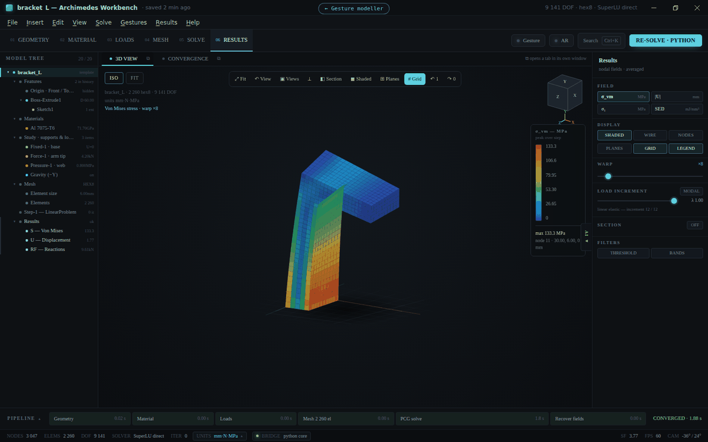
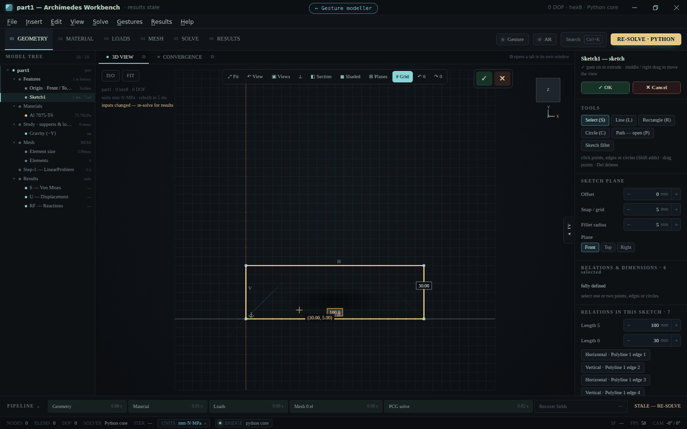
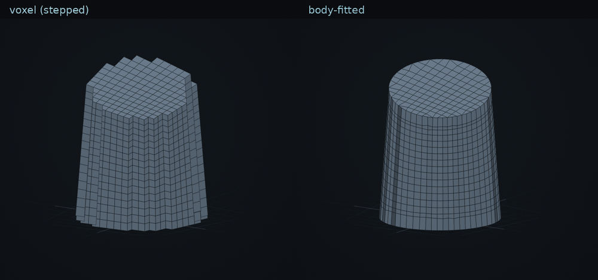
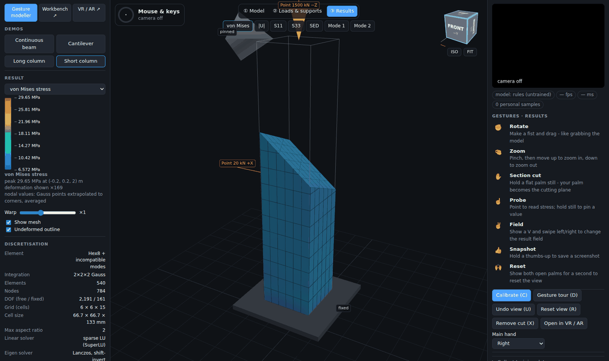
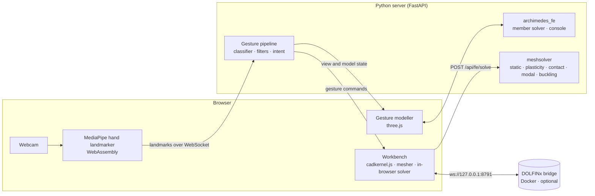

<div align="center">

# Archimedes

**Model, mesh and analyse engineering parts in the browser, and drive it all with your hands.**

A feature-based CAD modeller with a finite-element solver behind it, plus a computer-vision gesture layer that
lets you build members, cut sections and probe results with an ordinary webcam.

[](https://github.com/si-ux/archimedes/actions/workflows/ci.yml)


[](https://github.com/astral-sh/ruff)
[](https://codespaces.new/si-ux/archimedes)



</div>

---

## Contents

- [What is Archimedes?](#what-is-archimedes)
- [Features](#features)
- [Quick start](#quick-start)
- [Usage](#usage)
- [Architecture](#architecture)
- [Validation](#validation)
- [Project layout](#project-layout)
- [Development](#development)
- [Roadmap and known limitations](#roadmap-and-known-limitations)
- [Contributing](#contributing)
- [License](#license)
- [Acknowledgements](#acknowledgements)

## What is Archimedes?

Archimedes started as the final project of the Atomcamp Computer Vision track: a hand-gesture interface for
exploring finite-element (FE) results. It has grown into two connected applications served by one Python server:

| App | URL | What it is |
|---|---|---|
| **Gesture modeller** | `/` | Build beams and columns, apply supports and loads, solve and explore the results by hand gesture, mouse or Python console. |
| **Workbench** | `/workbench/` | A SolidWorks / CATIA style part modeller with sketches, a feature tree and a body-fitted hex mesher. It runs static, nonlinear, modal and buckling analyses, and can also be driven by gestures. |

Hand tracking runs **in your browser** (MediaPipe in WebAssembly). Only about 1 KB of landmark coordinates per frame
goes to the Python server, and no video ever leaves your machine. That is why it also works in a GitHub Codespace,
which has no webcam of its own.

## Features

### Workbench: CAD and FE analysis

- **Feature-based modelling.** Sketches (lines, rectangles, circles, open paths, sketch fillets), extrude, revolve,
  loft, sweep, 3D edge fillets and chamfers, shell, box / cylinder / sphere, hole, linear and circular patterns,
  mirror and imported STL bodies, all in an editable feature tree.
- **Parametric sketches.** A constraint solver with relations (horizontal, vertical, parallel, perpendicular, equal,
  tangent, coincident, point-on-line, fix) and driving dimensions. Sketches show when they are fully defined,
  under-defined or conflicting.
- **Direct editing.** A PropertyManager (✓ / ✕) for every feature, drag arrows on faces, a Modify box, undo / redo,
  and SolidWorks or CATIA mouse bindings.
- **Body-fitted meshing.** Hex8 elements whose surface nodes are projected onto the real CAD surfaces, with
  Jacobian checks. A plain voxel mesh is still available as an option.
- **Analyses.** Linear static, nonlinear (J2 plasticity), modal and linear buckling, with fixed, roller,
  compression-only contact, force, pressure, gravity and thermal loads.
- **Three solver engines.** In the browser (no install), the Python FE core (sparse direct or AMG-preconditioned CG,
  incompatible-mode hex8), or FEniCSx / DOLFINx in Docker.
- **Post-processing.** von Mises, principal stress, displacement, strain energy and plastic strain, plus animated
  mode shapes, section cuts, thresholds, CSV / STL export and a WebXR (VR / AR) viewer.

<p align="center">
  
  
</p>

### Gesture layer: computer vision

- **One-hand control.** Six poses that are easy to tell apart (fist, pinch, flat palm, point, V, thumbs-up). A
  relaxed hand never moves the model.
- **Section cuts with your palm.** Your hand *is* the cutting plane; close it to lock the cut.
- **Robust recognition.** Rigid-palm motion, EMA plus hysteresis, One Euro filtering and plain-language quality
  hints ("too dark", "hand at edge").
- **Personalisation.** A 30-second calibration detects handedness and fits a few-shot k-NN adapter to your hand.
- **Gesture modelling.** Pull a beam out with two pinches, enter dimensions by holding up fingers, place supports
  and loads, and solve with a thumbs-up.
- **Python console.** Abaqus-style commands (`beam(...)`, `pinned(...)`, `solve()`), your own scripts, and a journal
  that replays every gesture and mouse edit as a command.

<p align="center">
  
</p>

## Quick start

### Option 1: GitHub Codespaces (no installation)

1. Click **Code ▸ Codespaces ▸ Create codespace on main**, or use the badge above. The dev container installs
   everything on first start.
2. In the terminal, run:
   ```bash
   make demo
   ```
3. Open the forwarded **port 8000**. Click **Enable camera**, or **Watch demo** for a scripted tour that needs no
   camera. The Workbench is at `/workbench/`.

### Option 2: Local installation

You need **Python 3.10 to 3.12**, plus **Node.js 18+** if you want to run the CAD kernel tests.

```bash
git clone https://github.com/si-ux/archimedes.git
cd archimedes
python -m venv .venv
source .venv/bin/activate            # Windows: .venv\Scripts\activate
pip install -r requirements-dev.txt
pip install -e .
make demo                            # or: python -m uvicorn webdemo.server:app --port 8000
```

Then open <http://localhost:8000> (gesture modeller) or <http://localhost:8000/workbench/> (Workbench).

> [!NOTE]
> The browser needs camera permission. Browsers only grant it on `localhost` or over HTTPS. On Linux, the desktop
> MediaPipe app also needs `libegl1 libgles2 libgl1` (`sudo apt install libegl1 libgles2 libgl1`).

### Option 3: Add the DOLFINx solver core (optional)

The Workbench can send static solves to FEniCSx / DOLFINx running in Docker:

```bash
cd Archimedes/backend
docker compose up            # starts the solver bridge on ws://127.0.0.1:8791
```

Then choose **ENGINE ▸ DOLFINX** (or AUTO) in stage 05 of the Workbench. See
[`Archimedes/backend/README.md`](Archimedes/backend/README.md).

### Option 4: Desktop app with a native camera window

```bash
pip install -r requirements.txt pyvista
python apps/desktop_demo.py                                    # camera window with skeleton and HUD
python apps/desktop_demo.py --pyvista result.vtu --field VonMises --field U
```

## Usage

### Workbench in five steps

1. **Geometry:** start from a template (**File ▸ New from template**) or sketch on a plane and extrude it.
2. **Material:** pick from the library or define a custom material (E, ν, ρ, yield, hardening, expansion).
3. **Loads:** select faces, then add **Fixed**, **Roller**, **Contact**, **Force** or **Pressure**.
4. **Mesh:** set the element size; keep the body-fitted surface on for curved parts.
5. **Solve:** choose the analysis (Static, Nonlinear, Modal, Buckling) and the engine, then press **SOLVE**.

The full guide is in [`Archimedes/docs/cad-workflow.md`](Archimedes/docs/cad-workflow.md).

### Gestures

| Hold… | to… | then… |
|---|---|---|
| ✊ fist | rotate | drag, like grabbing the model |
| 🤏 pinch | zoom | move up / down |
| ✋ flat palm (still) | section cut | your palm *is* the cutting plane; close the hand to lock |
| ☝️ point | probe | the fingertip is the cursor; hold still to pin a value |
| ✌️ V | change field | swipe left / right |
| 👍 thumbs-up (still) | snapshot (solve in the Workbench) | |
| 🙌 both palms | reset | |

Mouse and keyboard always work too. The gesture vocabulary and the reasoning behind it are in
[`docs/DESIGN.md`](docs/DESIGN.md) and [`Archimedes/docs/gestures.md`](Archimedes/docs/gestures.md).

### Python console

Open it with the 🐍 button or the <kbd>`</kbd> key in the gesture modeller, or run it without a browser:

```python
beam(b=300, h=500, L=6000)
pinned(at=0); roller(at=1)
uniform(10)          # kN/m
solve()
peak('U3')
```

See [`docs/SCRIPTING.md`](docs/SCRIPTING.md) and the examples in [`fe_scripts/`](fe_scripts/).

### FE solver over HTTP

The Python FE core takes any hex8 mesh:

```python
import json, urllib.request
from archimedes_fe.meshsolver import box_mesh

nodes, elems = box_mesh(20, 2, 4, 1000.0, 50.0, 100.0)            # mm
root = [i for i, p in enumerate(nodes) if p[0] == 0]
tip = [i for i, p in enumerate(nodes) if p[0] == 1000]
f = [0.0] * nodes.size
for i in tip:
    f[3 * i + 1] = -1000.0 / len(tip)                              # 1 kN down at the tip

body = {"nodes": nodes.ravel().tolist(), "elems": elems.ravel().tolist(),
        "fixed": [3 * i + k for i in root for k in range(3)], "f": f,
        "material": {"E": 210000, "nu": 0.3, "rho": 7850},
        "analysis": "modal", "n_modes": 2}
req = urllib.request.Request("http://localhost:8000/api/fe/solve", json.dumps(body).encode(),
                             {"Content-Type": "application/json"})
print([m["f"] for m in json.load(urllib.request.urlopen(req))["modes"]])   # ≈ [42.0, 83.5] Hz
```

`GET /api/fe/info` lists the available analyses. The request format is documented in
[`Archimedes/docs/cad-workflow.md`](Archimedes/docs/cad-workflow.md#mesh-and-solver).

## Architecture



## Validation

Every solver is checked against closed-form results in the test suite and in the browser:

| Case | Archimedes | Theory |
|---|---|---|
| Cantilever tip deflection (incompatible-mode hex8) | 0.379 mm | 0.384 mm (Timoshenko) |
| Cantilever natural frequencies | 90.9 / 135.6 Hz | 90.6 / 135.9 Hz (Euler–Bernoulli) |
| Column buckling load | 6.915 kN | 6.909 kN (π²EI / 4L²) |
| Bar beyond yield: plastic strain | 0.02500 | (σ − σy) / H = 0.025 |
| Bar held at both ends, ΔT = 50 K | −126.0 MPa | −Eα·ΔT = −126 MPa |
| Plate with a hole, body-fitted mesh at 3 mm | 75.0 MPa | ≈ 74.7 MPa (Kt on the net section) |
| Patch test on distorted elements | error 1e-13 | exact |

## Project layout

```
archimedes/
├── Archimedes/               Workbench: page, cadkernel.js (CAD kernel), DOLFINx backend, docs
│   ├── backend/              FEniCSx / DOLFINx solver core and WebSocket bridge (Docker)
│   └── docs/                 CAD workflow, gesture vocabulary, assistant design notes
├── archimedes_fe/            FE core: member model, brick solver, general hex8 meshsolver, console
├── archimedes_gestures/      CV pipeline: landmarks, features, classifier, filters, intent, calibration
├── webdemo/                  FastAPI + WebSocket server, gesture modeller page, WebXR viewer
├── apps/                     Desktop OpenCV / MediaPipe app
├── scripts/                  Training and evaluation scripts (HaGRID extraction, One Euro tuning)
├── fe_scripts/               Example console scripts
├── docs/                     Design, modelling and scripting guides, README images
└── tests/                    pytest suite + CAD kernel tests (Node)
```

## Development

```bash
make test        # pytest: 95 tests; also runs the 18 CAD kernel tests when Node is installed
make lint        # ruff
make demo        # dev server on port 8000
```

No camera or GPU is needed for the tests. Before you open a pull request, read
[CONTRIBUTING.md](CONTRIBUTING.md).

<details>
<summary><b>Capstone workflow (gesture recognition research)</b></summary>

| Phase | Do | Command |
|---|---|---|
| 1 Landmarks and logging | record labelled 3-second clips per pose, one subject ID per person | web demo → *Collect training data* |
| 2 Static classifier | extract HaGRID landmarks, train, evaluate on unseen people | `python scripts/extract_hagrid.py …` then `make train` |
| 3 Dynamic gestures | swipe detector and DTW few-shot baseline | `archimedes_gestures/dynamic.py` |
| 4 Continuous control | tune One Euro: jitter vs lag on recorded clips | `python scripts/evaluate_filter.py` |
| 5 Robustness | dim light, clutter, sleeves, a second person | web demo |
| 6 User study | 4 tasks, gestures vs mouse, 6 to 10 participants | web demo |

`make train-smoke` and `make filter-smoke` run the same scripts on synthetic hands, to check the pipeline before
you have data. Don't report those numbers.

</details>

## Roadmap and known limitations

- **Mesh:** the body-fitted mesh still shows small flattened facets on gently sloping lofted surfaces. A tetrahedral
  or pillowed hex mesher would remove them.
- **Speed:** large in-browser solves are slow (about 35 s for 18k elements). Use the Python core or DOLFINx for big
  models.
- **DOLFINx scope:** the posted-mesh DOLFINx path is linear static only. Nonlinear, contact, modal and buckling run
  on the Python core.
- **Design assistant:** the assistant tab is interface only (see
  [`Archimedes/docs/assistant-backend.md`](Archimedes/docs/assistant-backend.md)).

Ideas and bug reports are welcome in [Issues](https://github.com/si-ux/archimedes/issues).

## Contributing

Contributions are welcome. Please read [CONTRIBUTING.md](CONTRIBUTING.md) and follow the
[Code of Conduct](CODE_OF_CONDUCT.md). To report a security problem, see [SECURITY.md](SECURITY.md). Changes are
listed in [CHANGELOG.md](CHANGELOG.md).

## License

No license has been chosen yet. Until a `LICENSE` file is added, the code is under default copyright: you may view
it and fork it on GitHub, but not reuse it elsewhere.

## Acknowledgements

- [Atomcamp](https://www.atomcamp.com/), where this started as a Computer Vision capstone project
- [MediaPipe](https://ai.google.dev/edge/mediapipe) hand landmarker (Apache-2.0)
- [FEniCSx / DOLFINx](https://fenicsproject.org/) (LGPL-3.0), [PETSc](https://petsc.org/) and
  [Gmsh](https://gmsh.info/) in the optional solver container
- [NumPy](https://numpy.org/), [SciPy](https://scipy.org/), [PyAMG](https://github.com/pyamg/pyamg),
  [scikit-learn](https://scikit-learn.org/), [FastAPI](https://fastapi.tiangolo.com/),
  [three.js](https://threejs.org/) and [React](https://react.dev/)
- The [HaGRID](https://github.com/hukenovs/hagrid) hand gesture dataset, used for training the pose classifier
